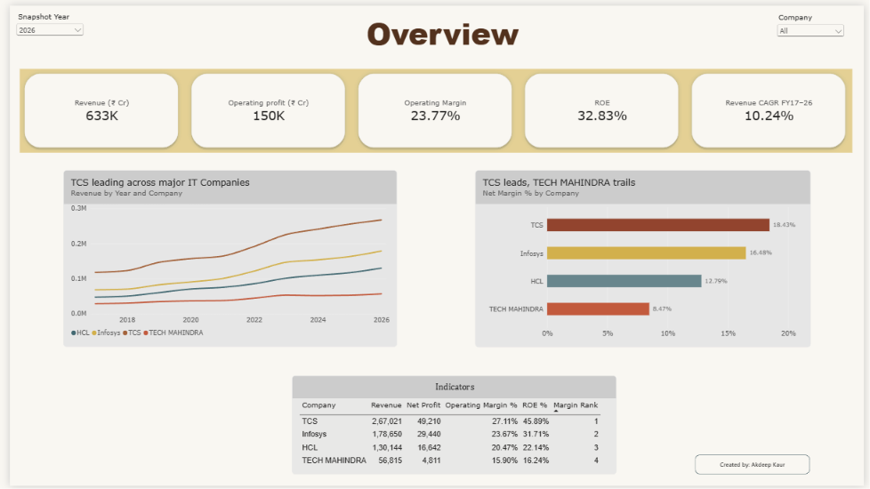
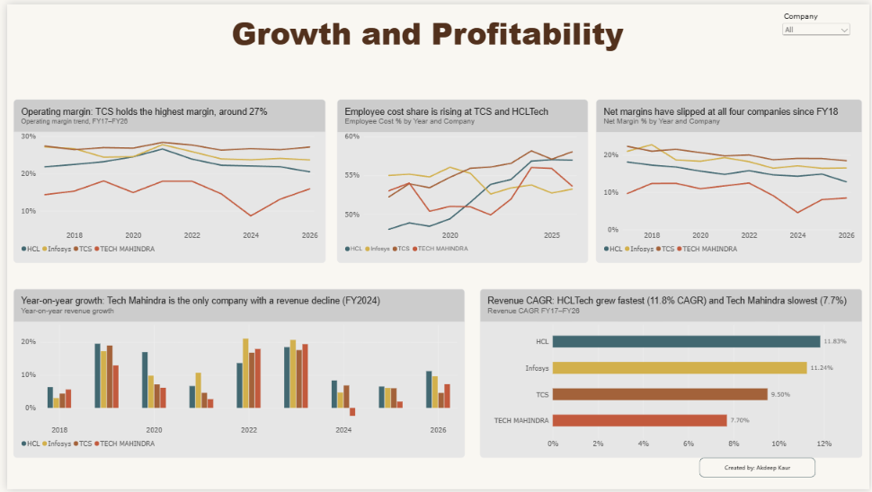
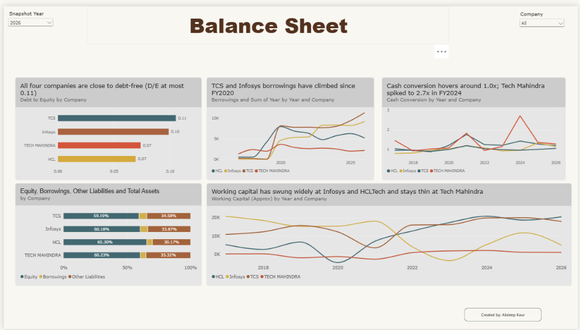
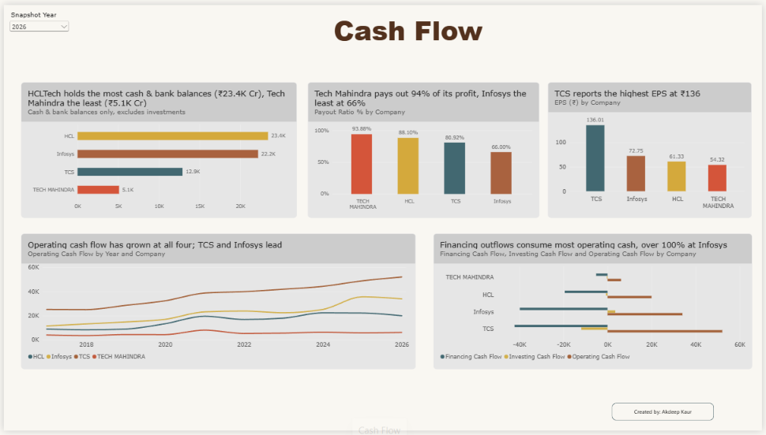
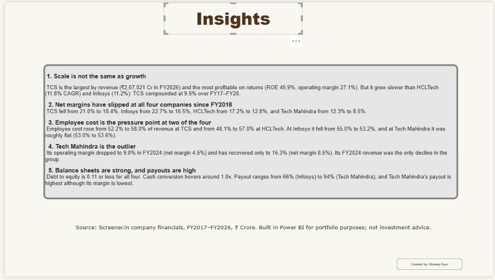

Power BI dashboard benchmarking TCS, Infosys, HCLTech and Tech Mahindra, FY2017–FY2026
# Indian IT Sector Benchmarking: TCS, Infosys, HCLTech & Tech Mahindra (FY17–FY26)

A 4-page Power BI dashboard benchmarking India's top four IT services companies on scale, growth, profitability, employee cost pressure, and balance sheet health over a 10-year period (FY2017–FY2026).

**[View Full PDF Report](Indian_IT_Benchmarking.pdf)**

## Dashboard Preview

### 1. Overview

### 2. Growth & Profitability

### 3. Balance Sheet & Cash Flow

### 4. Key Insights

## Key Findings
* **Scale vs. Growth:** TCS leads in FY26 revenue (₹2,67,021 Cr), ROE (45.9%), and operating margin (27.1%), but compounded slower (9.5% CAGR) than HCLTech (11.8% CAGR) and Infosys (11.2% CAGR) over FY17–FY26.
* **Sector-Wide Margin Compression:** Net margins slipped across all four companies since FY18—TCS (21.0% to 18.4%), Infosys (22.7% to 16.5%), HCLTech (17.2% to 12.8%), and Tech Mahindra (12.3% to 8.5%).
* **Employee Cost Pressure:** Employee cost as a share of revenue climbed sharply at TCS (52.2% to 58.0%) and HCLTech (48.1% to 57.0%), whereas Infosys improved efficiency (55.0% to 53.2%).
* **Tech Mahindra Outlier:** Recorded the group's only revenue decline in FY24 alongside a sharp margin trough (9.0% operating margin; 4.5% net margin) before partially recovering to 16.3% operating margin by FY26.
* **Strong Balance Sheets & High Payouts:** All four operate virtually debt-free (Debt-to-Equity ≤ 0.11) with ~1.0x cash conversion, while dividend payout ratios range from 66% (Infosys) to 94% (Tech Mahindra).

## Data Source & Tools
* **Source:** Screener.in consolidated company financials (FY2017–FY2026, figures in ₹ Crore).
* **Tools:** Power BI Desktop, Power Query, DAX (CAGR, YoY growth, financial ratios, dynamic ranking).
